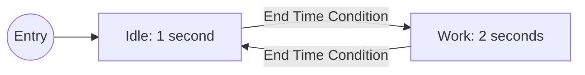
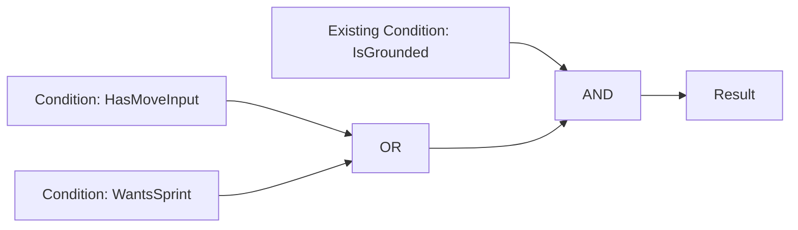
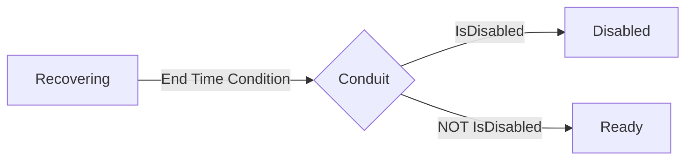

# JP State Machine — How to Use

A practical guide to creating gameplay state machines in **Unreal Engine 5.8**.
Use Gameplay Tags to identify states, Blueprints or C++ for their behavior, and
visual graphs to define when they change.

[Get the plugin on Fab](https://www.fab.com/listings/b63f7758-9cb1-46e6-96b3-3431216d97d6)
| [What's new](WHATS_NEW.md)
| [Support](https://github.com/KhaninVladimir/StateMachineSystemDocs/issues)

This page covers the standalone JPStateMachine 1.0.0 source distribution. All
usage instructions are on this page; the separate What's New file contains the
changes compared with the previous manual.

## Contents

- [Install and enable](#install-and-enable)
- [Create your first state machine](#create-your-first-state-machine)
- [Create custom state behavior](#create-custom-state-behavior)
- [Create transition conditions](#create-transition-conditions)
- [Combine conditions with AND, OR, and NOT](#combine-conditions-with-and-or-and-not)
- [Organize states with SubTrees](#organize-states-with-subtrees)
- [Route transitions through Conduits](#route-transitions-through-conduits)
- [Share action restrictions and cancel states](#share-action-restrictions-and-cancel-states)
- [Control the machine from gameplay](#control-the-machine-from-gameplay)
- [Use the plugin in multiplayer](#use-the-plugin-in-multiplayer)
- [Integrate with C++](#integrate-with-c)
- [Debug and troubleshoot](#debug-and-troubleshoot)

## Install and enable

1. Install the plugin for UE 5.8 through Fab, or place a source copy at
   `YourProject/Plugins/JPStateMachine/JPStateMachine.uplugin`.
2. For a source-only copy, use a C++ project with a configured UE toolchain,
   generate project files, and build the project's Editor target.
3. Open **Edit > Plugins**, enable **JP State Machine**, and restart if prompted.

Install one copy of the plugin, either in the engine or the project. After
installation, the following workflows can be authored in Blueprint. The plugin
uses built-in engine functionality; no additional third-party plugin is required.

## Create your first state machine

This example alternates between Idle for one second and Work for two seconds.
It uses the included delay state and needs no custom state or condition class.

### 1. Register state tags

In **Project Settings > Gameplay Tags**, add `State.Demo.Idle` and
`State.Demo.Work`. Save the settings. A node's display name is only a label;
**State Tag** is its runtime identity.

### 2. Create and configure the graph

1. In the Content Browser, choose **State Machine > State Machine Editor**.
   Name the asset `SM_Demo` and open it.
2. Right-click the canvas and choose **Add State** twice.
3. Configure the two nodes through their Details and inline state parameters:

| Node | State Class | State Tag | Duration |
| --- | --- | --- | --- |
| Idle | JP Delay State (`JPDelayState`) | `State.Demo.Idle` | 1.0 |
| Work | JP Delay State (`JPDelayState`) | `State.Demo.Work` | 2.0 |

4. Connect **Entry** to Idle, Idle to Work, and Work back to Idle.
5. Select each transition bubble. Set **Condition Mode = Single Condition** and
   **Condition Class = JP End Time Condition** (`JPEndTimeCondition`).
6. Click **Compile**, resolve any errors, and save.



If a class is hidden, check **Graph Class Filters**. Enabling the individual
picker's **ContextSensitive** checkbox shows classes outside that base-class filter.

End Time Condition checks the source delay state's duration. A delay state does
not switch by itself: it needs an outgoing transition. An empty Condition Class
is a validation error, not an always-true rule.

### 3. Run it on an Actor

1. Create an Actor Blueprint named `BP_StateMachineDemo`.
2. Add **State System Component**, assign `SM_Demo` to **State Graph**, and leave
   **Auto Start** enabled.
3. Place the Actor in a level and start **Play In Editor**.
4. Open the graph and select your Actor/component in **PIE Debug**.

Idle and Work should alternate, with transitions on the first applicable component
tick after each duration. Keep the component tick enabled.

To print changes, bind **On State Changed**, convert New State to text, and use
Print String. To observe the initial entry reliably, disable Auto Start, bind the
event in the Actor's BeginPlay, then call **Start State Machine**. A BeginPlay
binding can otherwise occur after the component has already auto-started.

## Create custom state behavior

1. Create **State Machine > State**, using `JPBaseState` as the parent.
2. Name it, for example, `BP_AttackState`, and assign a valid State Tag.
3. Implement the events needed by your behavior:

| Event | Typical use |
| --- | --- |
| **OnEnter** | Initialize activation data, start an animation or effect |
| **OnTick** | Update behavior while the state is active |
| **OnCancel** | Handle an interruption before the state exits |
| **OnExit** | Stop effects, unbind callbacks, and release state-owned resources |

4. Select the Blueprint as the graph node's **State Class**.
5. Edit per-node parameters, compile the Blueprint and graph, then save.

Use **Get Owner Actor** and **Get State Component** inside state logic. Multiple
nodes can use the same class with different settings. Each component creates its
own runtime instances from the node templates; normal re-entry reuses the instance,
so reset your own per-activation variables in OnEnter.

**Tick Enabled** controls OnTick callbacks. The state's local timer still advances
when the component ticks, even with Tick Enabled off. **Get Time In State** returns
that timer. For a state with the built-in Duration setting, derive from
`JPDelayState`; End Time Condition returns false for other state types.

Put general cleanup in OnExit, since ordinary transitions, restarts, cancellation,
and stopping can all exit a state. An actively cancelled state receives OnCancel
before OnExit. A state redirected before entry receives neither OnEnter nor OnCancel.

## Create transition conditions

1. Create **State Machine > Condition**, deriving from `JPStateCondition`.
2. Override **Evaluate** and return a boolean from your Actor's gameplay data.
3. Assign the class to a transition and configure its inline parameters.
4. Compile and save the condition Blueprint and graph.

For example, create `BP_HasMoveInput`: cast Owner Actor to your character class,
read its movement-request value, and return whether movement is requested.
Use it for Idle → Walk. On Walk → Idle, use the same condition with
**Invert Result** enabled.

Evaluate receives **Owner Actor**, **State Component**, **Current State**, and
**Next State**. Current State is the source of the evaluated transition; for a
parent-level rule this is the parent, even when the component's current state is
its leaf. Next State is null when the immediate target is a Conduit.

Keep Evaluate free of actions such as switching states, spawning Actors, or changing
tags: it can run repeatedly while searching for a valid transition. Put actions in
state callbacks. For an unconditional edge, create a concrete `BP_AlwaysTrue`
condition whose Evaluate returns true.

**Invert Result** is a condition setting. **Blocked By Flags** checks the shared
tag container described below and blocks the transition regardless of inversion.

## Combine conditions with AND, OR, and NOT

Use **Condition Graph** mode when a transition depends on several predicates.
For example: `IsGrounded AND (HasMoveInput OR WantsSprint)`.

1. Create the three condition Blueprints and implement their Evaluate functions.
2. Assign IsGrounded as the transition's original Single Condition.
3. Change **Condition Mode** to **Condition Graph** and double-click the transition.
4. The default **Existing Condition → Result** connection preserves IsGrounded.
5. Add two **Condition** nodes for HasMoveInput and WantsSprint. Combine them with
   **OR**, then combine OR and Existing Condition with **AND**.
6. Connect AND to **Result**, compile the state-machine asset, and save.



**Condition** nodes own their own settings. **Existing Condition** uses the original
condition on this particular transition; it does not select another transition's
condition. Selecting it shows the owning transition's parameters. You may replace
it entirely with new Condition nodes if the original predicate is unnecessary.

Use **NOT** to invert a connected result. AND/OR short-circuit, and a reused node's
result is evaluated once per expression evaluation. Connect every input leading
to the single Result node; cycles are invalid.

**Blocked By Flags is a hard gate for the whole compiled rule.** If any included
condition is blocked, OR, NOT, or inversion cannot bypass it. For a branch-local
alternative, implement that test inside Evaluate instead of Blocked By Flags.

## Organize states with SubTrees

A SubTree is an active parent state that also runs another graph.

1. Create a child graph, such as `SM_Movement`, with Idle and Walk states and its
   own Entry connection.
2. In the outer graph, choose **Add SubTree**.
3. Assign a concrete parent **State Class**, give its template a State Tag such as
   `State.Movement`, and set **Sub State Graph = SM_Movement**.
4. Optionally enable **Enforce Child Tag Hierarchy** and name the children
   `State.Movement.Idle` and `State.Movement.Walk`.
5. Connect the outer Entry to the SubTree. Compile and save both graphs.

While Walk runs, the active path is `Movement → Walk`. Both states remain active
and tick. Moving between Idle and Walk keeps Movement active, including its timer
and shared tags. Leaving Movement exits its child first, then the parent.

Add high-level transitions such as Movement → Disabled to the outer graph instead
of repeating them on every child. Parent transitions are evaluated before child
transitions. Within a graph, the first passing compiled transition wins; canvas
position does not set priority, so prefer mutually exclusive branches.

Each graph must use unique state tags locally. Avoid recursive graph references.
When hierarchy enforcement is enabled, child tags must be strict descendants of
the parent tag. Entering a SubTree follows its child graph's initial path.

**Get Current State** returns the leaf. **Has State Tag** matches the leaf tag or
its Gameplay Tag ancestors; it does not inspect every active parent object. Use
hierarchical tag names when that query should identify an active branch.

## Route transitions through Conduits

Use **Add Conduit** to share a routing decision without creating another active
state. For example, route a completed Recovering delay to Ready or Disabled:



Assign IsDisabled to both outgoing rules and enable Invert Result for the Ready
edge. All edges need valid conditions. The conduit is resolved in the same search;
it has no State Tag, callbacks, timer, or persistent active state.

Entry cannot target a Conduit. Provide a route to a State or SubTree and avoid
conduit cycles. If no complete route passes, the original source remains active.
All conditions along a conduit route receive the original Current State; Next
State is null on edges whose immediate destination is another conduit.

## Share action restrictions and cancel states

### Set up the shared container

1. Add **State Tag Container** to your Actor Blueprint.
2. In **Class Settings > Implemented Interfaces**, add
   `JPStateTagContainerInterface`.
3. Implement **Get State Tag Container** and return that component.

Adding the component alone is insufficient: the Actor interface supplies it to the
state machines. Multiple State System Components can return the same container.
An inventory Actor can also return its character's container through its interface.
Keep that reference stable while the machines run.

### Example: prevent jumping during reload

1. Register `Action.Jump` and add it to Reload's **Banned Flags**.
2. Before executing your jump action, query **Is Flag Banned** on a State System
   Component with Action.Jump. Only jump when false.
3. Alternatively, add Action.Jump to the jump transition's **Blocked By Flags**.

Active states contribute flags on entry and remove them after OnExit. Contributions
are counted, so one state leaving does not remove another state's restriction.
Flags do not disable input automatically; your action/condition must check them.
Matching is exact: `Action` does not automatically match `Action.Jump`.

### Example: sprint interrupts reload

Use separate Movement and Weapon machines sharing that container.

1. Register `Cancel.Weapon.Reload`.
2. In Sprint, add it to **Cancel States With Tags**.
3. In Reload, add it to **Cancelled By Tags**.
4. Set Reload's **Cancel Transition State Tag** to Ready's tag, for example,
   `State.Weapon.Ready`. Ready must be a different valid state in the same graph.
5. Compile both graphs.

If Reload is active when Sprint publishes the tag, Reload receives OnCancel,
then OnExit, and the Weapon machine enters Ready. A normal transition edge to
Ready is not required for this fallback. Attempting to enter Reload while the tag
is already present redirects to Ready without entering Reload.

Leaving Sprint removes its contribution but does not automatically resume Reload.
A cancelled parent exits its child branch; do not assume every child receives its
own OnCancel. Avoid fallback chains that cancel each other indefinitely.

### Publish tags from other systems

Use **Set Cancel Tags For Source** with a live UObject and its tags. Calling it
again replaces only that source's contribution. When the ability/effect ends, call
**Remove Cancel Tags For Source**. Keep the source alive and explicitly remove it;
weak-source cleanup happens on a later refresh, not on a dedicated cleanup tick.

The counted **Add/Remove Cancel Tags** and **Add/Remove Banned Flags** APIs must be
balanced. Set/Clear Banned Flags resets the entire flag store, so avoid using it
to remove one contribution while other states still own flags.

## Control the machine from gameplay

Get the Actor's State System Component and use these Blueprint nodes:

| Node | Use |
| --- | --- |
| Start / Stop State Machine | Begin the initial path or exit the active path |
| Switch State By Tag | Select a destination directly |
| Restart State By Tag | Exit and re-enter an active state and its descendant branch |
| Get Current State / Tag / Time | Read the active leaf and its local lifetime |
| Has State Tag | Test the leaf's tag hierarchy |
| Find State By Tag | Obtain a runtime state instance, including an inactive one |
| Is Flag Banned | Query the shared container |
| On State Changed | Receive previous and new leaf tags after a completed path change |

Switching to the unchanged current path does not replay OnEnter. Use Restart for
that. Restarting a parent returns its child branch to its initial path; ancestors
above the restarted state remain active. Restarting an inactive tag returns false.

Direct Switch does not evaluate outgoing transition conditions. Cancellation can
still redirect the destination. If callbacks change the path, a successful call
need not leave the originally requested state active; query the resulting tag.

Tag lookup prefers active graph contexts. Use unambiguous tags when outside
systems must target a particular inactive branch. A restart can report equal
previous/new tags through On State Changed. Stop runs exit callbacks but does not
broadcast On State Changed to an empty tag; handle shutdown through your stop
logic or state exit events.

## Use the plugin in multiplayer

1. Enable **Replicates** on the owning Actor.
2. Leave replication enabled on State System Component and assign the same graph
   and plugin version on server and clients.
3. Start, stop, switch, and restart on authority. For player requests, implement
   your own validated Server RPC on an owned Actor and call the component there.

Public control calls are local functions, not RPCs. The server evaluates automatic
transitions and cancellations; clients apply the replicated active path. Local
state callbacks also run on clients, so guard authoritative damage, inventory,
and spawning logic with authority checks.

Replication includes the parent-to-leaf path, activation IDs, start timestamps,
and a bounded recent cancellation history. Restarting creates a new activation
even when the tag is unchanged. Clients enter the received child path without
first entering that SubTree's default child.

Custom state variables, external shared tags, and every intermediate transition
are not automatically replicated. Replicate additional gameplay data through your
Actor/components. There is no built-in prediction or rollback.

### Choose the correct timer

| Query | Meaning |
| --- | --- |
| Get Time In State / Get Current State Time | Local time accumulated since entry; drives delay conditions |
| Get Current State Start Time Seconds | Authoritative activation timestamp in server world seconds |
| Get Current State Server Elapsed Time | Estimated server progress since that activation |

For client presentation, read server elapsed time in OnEnter and use it to choose
an animation/effect position. The timestamp is available before OnEnter. Local
timers are not automatically advanced for network latency.

Server elapsed time uses Unreal's GameState clock. It returns zero when inactive
or when a client has no GameState yet; zero can also be a valid duration. World
pause/time dilation and clock corrections affect the estimate. It is game time,
not UTC. The plugin supplies a timing value, not automatic montage seeking.

## Integrate with C++

Add the runtime module and GameplayTags to your game module's Build.cs:

```csharp
PublicDependencyModuleNames.AddRange(new[] { "JPStateMachine", "GameplayTags" });
```

Create the component in your Actor constructor and retain it in a UPROPERTY:

```cpp
#include "JPStateSystemComponent.h"

// Actor constructor; StateMachine is a UPROPERTY TObjectPtr<UJPStateSystemComponent>.
StateMachine = CreateDefaultSubobject<UJPStateSystemComponent>(TEXT("StateMachine"));
bReplicates = true;
```

Assign State Graph in the component defaults of an Actor Blueprint subclass.
Derive state classes from `UJPBaseState` and conditions from `UJPStateCondition`.
Override `K2_OnEnter_Implementation`, `K2_OnTick_Implementation`,
`K2_OnCancel_Implementation`, `K2_OnExit_Implementation`, or
`K2_Evaluate_Implementation` as appropriate. If overriding the lower-level
EnterState/TickState/ExitState directly, preserve base calls that manage timers,
tags, and delegates.

For shared tags, implement `IJPStateTagContainerInterface` on the owner and return
its container from `GetStateTagContainer_Implementation() const`. The component's
`GetStateTagContainer()` accessor is C++ only; Blueprint uses the Actor interface.

## Debug and troubleshoot

Compile the graph after changing its connections, templates, or condition rules,
then save. Inspect marked nodes, inline messages, and the Output Log. In PIE or
Simulate, choose the correct Actor/component and server/client world in **PIE Debug**.
Double-click state nodes to open their classes; double-click transitions to open
the condition class or its Condition Graph.

| Problem | Check |
| --- | --- |
| No active state | State Graph assigned, Auto Start or explicit Start, Entry connected to a valid state |
| Delay never exits | JPDelayState source, End Time Condition edge, component tick enabled, authority |
| Desired class missing | Graph Class Filters and the picker’s ContextSensitive checkbox |
| Rule fails to compile | Concrete condition, connected Result inputs, no cycles |
| Duplicate-rule error | Equivalent rules on the same source or adjacent edges; review parameters/inversion instead of duplicating the same predicate |
| Condition crashes on Next State | Conduit targets have no state instance; null-check Next State |
| Cancellation does nothing | Shared-container interface implemented, exact tags match, valid same-graph fallback |
| Same-state switch does not replay | Use Restart State By Tag |
| Has State Tag does not identify a parent | It matches leaf tag ancestry; use hierarchical child tags |
| Client switch does not affect server | Send a validated server request; control calls are local |
| No PIE debug match | Graph assigned directly or as a SubTree to an Actor in the running world |

Examples on this page describe setup and expected behavior; they are not a report
of completed gameplay or multiplayer testing. If a problem remains, include the
engine/plugin version, graph settings, relevant logs, and server/client context
when reporting it.
